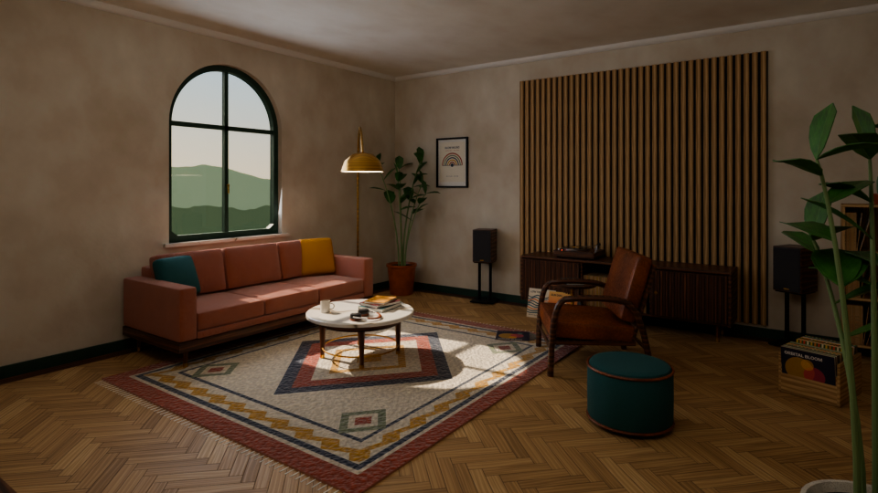

# Vinyl Lounge — procedural Blender 5.2 interior (advanced version)

Everything is generated by Python with Blender 5.2.2 LTS (`pip install bpy==5.2.2`):
a quad-only modelling toolkit, a numpy texture generator and a glTF-safe material library.
The final Full HD render was stopped on purpose, so only a 960×540 preview is included.

| Step | Command | Output |
|---|---|---|
| textures | `python gen_textures.py` (needs numpy, scipy, pillow) | `textures/*` |
| scene | `python build_scene.py` | `out/4SA1_Claude_Interier_v01.blend`, `.glb`, `layout.json` |
| concept board | `python concept_board.py` | `out/4SA1_Claude_Interier_v01.jpg` |
| render | `python render.py [--res 1920x1080 --samples 192]` | `out/4SA1_Claude_Interier_v01.png` |
| checks | `python verify.py` | `out/verification.md` |

* `lib/mk.py` — quad primitives: grid boxes, rounded boxes/cushions (Catmull-Clark), lathe and
  sweep with **quad-disk caps** (no triangle fans or n-gons), arched wall opening, arched glass pane.
* `lib/tex.py` — seamless herringbone parquet (exact brick tiling, no gaps), wood grain,
  phase-field marble veins, lime plaster, bouclé, leather, rug, vinyl labels, album covers.
* `lib/mats.py` — Principled BSDF materials fed only by image textures (export 1:1 to glTF).
* Scene: 38k faces, 0 triangles, 0 n-gons, every object ≥ 2 materials, 13 furniture objects,
  12 grabbables (`grabbable=1` custom property → glTF extras), front + right walls hidden from camera.
